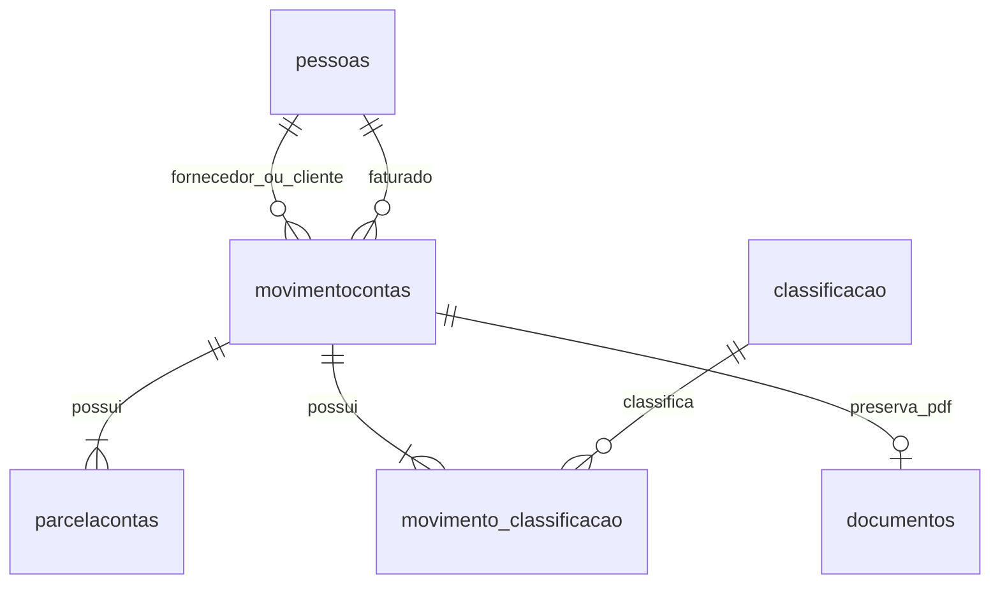

# RuralFin - Sistema de Controle Financeiro Rural

Autores do projeto: Luiz Fernando Alves Morais e Joao Victor Vieira Santos.

Continuação da primeira etapa em **Python/Flask**, **HTML/CSS/JavaScript** e
**PostgreSQL**. O pgAdmin administra o PostgreSQL; o Flask se conecta diretamente
ao banco por meio do Psycopg.

## O que a segunda etapa faz

1. Recebe o PDF e mantém a extração de dados pelo Gemini da primeira etapa.
2. Apresenta o JSON e um formulário para conferir ou corrigir os dados extraídos.
3. Consulta fornecedor/cliente pelo CPF/CNPJ, faturado pelo CPF e classificação
   pelo tipo e descrição. Mostra **EXISTE - ID** ou **NÃO EXISTE**.
4. Após a confirmação, cria os cadastros inexistentes e grava conta,
   classificações, parcelas e PDF em uma única transação.
5. Informa o ID da conta lançada e permite consultar o lançamento em **Contas**.

Há telas para pessoas, classificações e contas. As tabelas começam vazias;
**Buscar** aceita vários termos e **Todos os ativos** carrega os registros ativos.
Os títulos das colunas ordenam os registros. **Inativar** faz exclusão lógica;
o filtro **Inativos** permite encontrar e reativar registros.

## Regras implementadas

- Nenhum cadastro financeiro é excluído fisicamente pela aplicação. Triggers
  também bloqueiam DELETE nas quatro entidades principais pelo pgAdmin.
- O status nasce ATIVO e não pode ser alterado pelos formulários de criação/edição.
- Pessoas e classificações inativas não podem entrar em novos lançamentos.
  Reative-as primeiro. O histórico das contas permanece disponível.
- Uma conta tem uma ou mais classificações e uma ou mais parcelas, com
  vencimentos distintos. A soma das parcelas precisa corresponder ao total.
- Valores são validados com Decimal e guardados como NUMERIC(14,2).
- Máscaras de CPF/CNPJ são removidas antes da busca. Diferenças de maiúsculas,
  acentos e espaços na classificação não criam duplicatas.
- Os exemplos acadêmicos usam documentos fictícios; o sistema verifica formato
  e tamanho de CPF/CNPJ, sem exigir dígitos verificadores reais.
- Nota duplicada é detectada pela combinação tipo + pessoa + número da nota.
  O mesmo PDF também não pode gerar duas contas, mesmo com números diferentes.
- Se ocorrer falha ou duplicata, toda a transação é desfeita.
- Edições, inclusões, inativações e reativações ficam na tabela auditoria.
- PDFs ficam em BYTEA na tabela documentos, vinculados à conta. Assim, o backup
  do banco também inclui os documentos.

## Executar neste computador

A instância local está na pasta `.local-postgres`, com acesso somente pelo
endereço 127.0.0.1 e porta 5433. O banco e o usuário da aplicação são `ruralfin`
e `ruralfin_app`. A conexão completa está no `.env`, que não vai para o GitHub.

No PowerShell, dentro da pasta do projeto:

```powershell
powershell -ExecutionPolicy Bypass -File .\iniciar.ps1
```

Abra **http://127.0.0.1:5001**. O terminal precisa permanecer aberto enquanto usa
o site. Ctrl+C encerra o site. Para encerrar também o banco:

```powershell
.\.venv\Scripts\python.exe banco_local.py parar
```

Na tela de importação, informe uma chave do Gemini ou configure `GEMINI_API_KEY`
no `.env`. A chave digitada na tela não é gravada no banco. Os modelos podem ser
alterados na variável `GEMINI_MODELS` sem editar o Python.

## Preparar outro computador

Instale Python 3.12+ e PostgreSQL. Na pasta do projeto:

```powershell
python -m venv .venv
.\.venv\Scripts\python.exe -m pip install -r requirements.txt
.\.venv\Scripts\python.exe banco_local.py configurar
.\.venv\Scripts\python.exe -m flask --app app init-db
powershell -ExecutionPolicy Bypass -File .\iniciar.ps1
```

`banco_local.py configurar` usa a instalação padrão do PostgreSQL 16 no Windows
e cria uma instância própria para este projeto. Se a instalação for diferente,
defina `POSTGRES_BIN` com o caminho da pasta `bin`.

Para usar um servidor PostgreSQL já existente, crie o banco pelo pgAdmin, copie
`.env.example` para `.env`, preencha PGHOST, PGPORT, PGDATABASE, PGUSER e PGPASSWORD
e execute `flask init-db`. Não é necessário usar a instância local nesse caso.

## Consultar pelo pgAdmin

O servidor **RuralFin local** pode ser cadastrado automaticamente por este
trabalho. Se ainda não aparecer, feche e abra o pgAdmin novamente. Como alternativa,
importe `pgadmin-servidor.json` em **Tools > Import/Export Servers** e informe a
senha que consta em PGPASSWORD no seu `.env`.

Abra **Servers > RuralFin local > Databases > ruralfin > Schemas > public > Tables**.
Clique com o botão direito em uma tabela e use **View/Edit Data > All Rows**.
Para consultas SQL, abra **Query Tool** no banco `ruralfin`:

```sql
SELECT * FROM pessoas ORDER BY id;
SELECT * FROM classificacao ORDER BY id;
SELECT * FROM movimentocontas ORDER BY id;
SELECT * FROM parcelacontas ORDER BY movimento_id, numero;
SELECT * FROM movimento_classificacao;
SELECT movimento_id, nome_arquivo FROM documentos;
SELECT entidade, registro_id, operacao, usuario, ocorrido_em FROM auditoria ORDER BY id;
```

## Modelo do banco



| Arquivo | Responsabilidade |
|---|---|
| app.py | Flask, extração Gemini, login e proteção das requisições |
| financeiro.py | Consultas, cadastros e transação financeira |
| regras.py | Datas, documentos, valores, categorias e parcelas |
| db.py | Conexão PostgreSQL e comando init-db |
| sql/001_schema.sql | Tabelas, chaves, índices e bloqueio de exclusão |
| templates/ | Páginas HTML e formulários |
| public/static/ | Visual e comportamento da interface |
| banco_local.py | Preparação, início, parada e backup do banco local |
| tests/ | Testes de integração com PostgreSQL |

## Testes

```powershell
.\.venv\Scripts\python.exe -m pip install -r requirements-dev.txt
.\.venv\Scripts\python.exe -m pytest -q
```

Os testes usam esquemas temporários no mesmo PostgreSQL, não alteram os registros
da aplicação e não consomem a API do Gemini. A extração é testada com uma resposta
simulada do Google; testar uma nota real requer a chave do usuário e um PDF real.

A conta `DEMO-001`, quando presente, foi criada com dados fictícios para verificar
o fluxo da interface. Ela pode ser inativada pela tela Contas.

## Backup

```powershell
.\.venv\Scripts\python.exe banco_local.py backup
```

O arquivo é guardado em `tmp/backups` e inclui os PDFs. Para restaurar, crie um
banco vazio pelo pgAdmin e use **Restore**, selecionando o arquivo `.dump`.

## Publicação

O projeto está preparado para Flask na Vercel com PostgreSQL hospedado, por exemplo
Neon. O PostgreSQL deste computador atende somente ao uso local: o site publicado
precisa de sua própria conexão de banco na nuvem.

Repositório do projeto: https://github.com/olu1zx/ruralfin

Site publicado: https://ruralfin-n2.vercel.app

O banco online `ruralfin-db` foi criado no Neon (plano Free), com as tabelas da
etapa 2. Ele é separado do banco deste computador. O acesso ao site usa o usuário
`admin`; a senha gerada está somente no arquivo local `credenciais-site.txt`.
Esse arquivo não é enviado ao GitHub nem à hospedagem.

Para entregar no Classroom, use os links do repositório e do site acima. O
avaliador precisará das credenciais de entrada para utilizar o sistema.

Verificação da publicação: login, conexão PostgreSQL, consulta de cadastros,
lançamento de conta e parcela, bloqueio de duplicata, ordenação, inativação e
reativação passaram no ambiente online. Há uma conta `DEMO-ONLINE-001` com dados
fictícios para demonstração. A extração com Gemini foi preservada; o teste com
PDF real depende de uma chave fornecida pelo usuário.

1. Publique somente os arquivos do projeto no GitHub. `.env`, `.venv`, banco local,
   backups e credenciais já estão ignorados.
2. Importe o repositório na Vercel, no projeto RuralFin. Se publicar a pasta inteira
   Faculdade, defina a raiz `ruralfin`; prefira um repositório só para este projeto.
3. Crie/conecte um PostgreSQL hospedado e configure DATABASE_URL com TLS.
4. Configure APP_ENV=production, APP_USERNAME, APP_PASSWORD e SECRET_KEY.
   APP_PASSWORD é a senha de entrada do site, diferente da senha do banco.
5. Execute `sql/001_schema.sql` no banco hospedado ou `flask init-db` com a conexão
   desse ambiente. O esquema não deve ser inicializado em toda requisição.
6. Publique e teste login, extração, consulta, lançamento e leitura da conta.

Também é possível publicar o código local com `vercel --prod --scope luiz-b06f`,
após conferir o projeto vinculado com `vercel project inspect`. O envio pelo
terminal não depende da conexão de Git da Vercel. Para ativar publicação
automática a cada push, conecte sua conta GitHub em **Vercel > Settings >
Authentication > Login Connections** e então conecte o repositório ao projeto.

O login é uma conta acadêmica única, definida nas variáveis de ambiente. A chave
do Gemini pode continuar sendo informada na interface, ou configurada no servidor.
Na Vercel, o envio e download de PDF é limitado a **4 MB** pela aplicação, respeitando
o limite de payload da plataforma; no computador local o limite é 15 MB.

Referências: [Flask na Vercel](https://vercel.com/docs/frameworks/backend/flask),
[limites de funções](https://vercel.com/docs/functions/limitations),
[importação de servidores no pgAdmin](https://www.pgadmin.org/docs/pgadmin4/latest/import_export_servers.html),
[transações no Psycopg](https://www.psycopg.org/psycopg3/docs/basic/transactions.html),
[saída estruturada do Gemini](https://ai.google.dev/gemini-api/docs/generate-content/structured-output).

## Escopo acadêmico

Esta versão implementa a etapa 2 e mantém a etapa 1. A documentação inicial descreve
um produto mais amplo: importação automática de e-mail, baixas parciais,
comprovantes de pagamento, relatórios e perfis individuais continuam como evolução.
Contas e parcelas cadastradas não significam pagamento/recebimento realizado.

O PDF da etapa 2 informa entrega em **27/10/2026**; o da etapa 1 menciona
**28/10/2026** para a segunda entrega. Confirme a data válida no Classroom.
