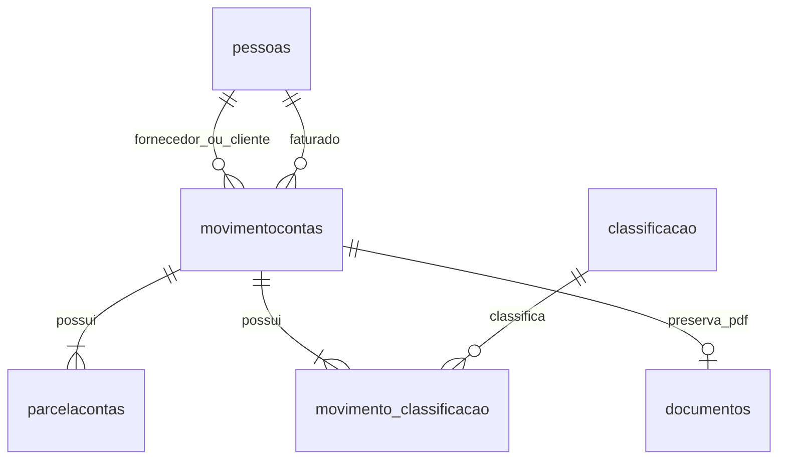

# RuralFin - Sistema de Controle Financeiro Rural

Autores do projeto: Luiz Fernando Alves Morais e Joao Victor Vieira Santos.

Continuação da primeira etapa em **Python/Flask**, **HTML/CSS/JavaScript** e
**PostgreSQL**. O pgAdmin administra o PostgreSQL; o Flask se conecta diretamente
ao banco por meio do Psycopg.

## Acessar sem instalar nada

Abra **https://ruralfin-n2.vercel.app** em qualquer computador ou celular com
internet. Entre com seu usuário e senha. O site funciona na Vercel, e os dados
ficam no PostgreSQL hospedado no Neon; seu computador pode permanecer desligado.
Você não precisa de Python, pgAdmin ou destes arquivos para usar o site.

Os arquivos desta pasta servem para estudar, alterar o código ou executar uma
versão local. O GitHub mantém uma cópia do código. Guarde suas credenciais de
acesso; para extração de PDFs, informe sua chave do Gemini na interface.

## O que a segunda etapa faz

1. Recebe o PDF e mantém a extração de dados pelo Gemini da primeira etapa.
2. Apresenta o JSON e um formulário para conferir ou corrigir os dados extraídos.
3. Consulta fornecedor/cliente e faturado pelo CPF/CNPJ e classificação
   pelo tipo e descrição. Mostra **EXISTE - ID** ou **NÃO EXISTE**.
4. Após a confirmação, cria os cadastros inexistentes e grava conta,
   classificações, parcelas e PDF em uma única transação.
5. Informa o ID da conta lançada e permite consultar o lançamento em **Contas**.

Há telas para pessoas, classificações e contas. As tabelas começam vazias;
**Buscar** aceita vários termos e **Todos os ativos** carrega os registros ativos.
Os títulos das colunas ordenam os registros. **Inativar** faz exclusão lógica;
o filtro **Inativos** permite encontrar e reativar registros.

A revisão segue a ordem da visualização: nota, fornecedor, faturado, produtos,
parcelas e classificações. Os dados extraídos e os cadastros existentes começam
bloqueados; use o cadeado e confirme para editar. Produtos e classificações têm
controles individuais de inclusão e remoção. Os produtos continuam guardados
na descrição da conta, sem uma entidade adicional de produtos.

## Apresentação e indisponibilidade da IA

1. Antes da apresentação, extraia a nota e use **Baixar .JSON** na versão atual.
   Guarde esse JSON e o PDF original juntos.
2. Se o Gemini demorar ou retornar erro, use **Cancelar espera**, selecione o
   mesmo PDF e abra **Usar uma extração salva** para carregar o JSON.
3. O sistema confere o vínculo entre os arquivos e permite revisar, consultar
   e lançar os dados sem uma nova chamada ao Gemini. A tela identifica que a
   extração foi recuperada; isso não simula uma extração nova.

O site e o banco ainda precisam de internet. JSONs antigos sem o vínculo do PDF
não podem ser usados nessa recuperação; exporte um arquivo atualizado antes.
A espera no navegador é limitada a 110 segundos, com opção de cancelamento.
Falhas temporárias da API têm tentativas limitadas; chave inválida não é repetida.

## Regras implementadas

- Nenhum cadastro financeiro é excluído fisicamente pela aplicação. Triggers
  também bloqueiam DELETE nas quatro entidades principais pelo pgAdmin.
- O status nasce ATIVO e não pode ser alterado pelos formulários de criação/edição.
- Pessoas e classificações inativas não podem entrar em novos lançamentos.
  Reative-as primeiro. O histórico das contas permanece disponível.
- Uma conta tem uma ou mais classificações e uma ou mais parcelas, com
  vencimentos distintos. A soma das parcelas precisa corresponder ao total.
- Valores são validados com Decimal e guardados como NUMERIC(14,2).
- Máscaras de CPF/CNPJ são removidas antes da busca. Diferenças de maiúsculas,
  acentos e espaços na classificação não criam duplicatas.
- Os exemplos acadêmicos usam documentos fictícios; o sistema verifica formato
  e tamanho de CPF/CNPJ, sem exigir dígitos verificadores reais.
- O faturado pode ser pessoa física ou jurídica. A extração usa `faturado.cpfCnpj`
  para o documento do destinatário; o JSON antigo com `faturado.cpf` continua aceito.
- Nota duplicada é detectada pela combinação tipo + pessoa + número da nota.
  O mesmo PDF também não pode gerar duas contas, mesmo com números diferentes.
- Se ocorrer falha ou duplicata, toda a transação é desfeita.
- Edições, inclusões, inativações e reativações ficam na tabela auditoria.
- PDFs ficam em BYTEA na tabela documentos, vinculados à conta. Assim, o backup
  do banco também inclui os documentos.

## Execução local — opcional

Para estudar ou alterar o projeto no Windows, instale Python 3.12+ e PostgreSQL 16.
Na primeira execução, abra o PowerShell na pasta do projeto e prepare o ambiente:

```powershell
python -m venv .venv
.\.venv\Scripts\python.exe -m pip install -r requirements.txt
.\.venv\Scripts\python.exe -m flask --app app banco-local configurar
.\.venv\Scripts\python.exe -m flask --app app init-db
```

Depois da preparação, basta iniciar o sistema com:

```powershell
powershell -ExecutionPolicy Bypass -File .\iniciar.ps1
```

Abra **http://127.0.0.1:5001** e mantenha o terminal aberto. Use Ctrl+C para encerrar
o site e `.\.venv\Scripts\python.exe -m flask --app app banco-local parar` para parar o banco.

O banco local fica em `.local-postgres`, na porta 5433; a conexão fica no `.env`,
que não vai para o GitHub. Se o PostgreSQL estiver instalado em outro caminho,
defina `POSTGRES_BIN` com a pasta `bin`. Para usar um banco existente, configure
os campos PGHOST, PGPORT, PGDATABASE, PGUSER e PGPASSWORD no `.env`, usando
`.env.example` como modelo, e execute `init-db` sem configurar a instância local.

Para extrair PDFs, informe sua chave do Gemini na interface ou configure
`GEMINI_API_KEY` no `.env`.

## Consultar pelo pgAdmin

O servidor **RuralFin local** pode ser cadastrado automaticamente por este
trabalho. Se ainda não aparecer, feche e abra o pgAdmin novamente. Como alternativa,
importe `.local-postgres/pgadmin-servidor.json` em **Tools > Import/Export Servers** e informe a
senha que consta em PGPASSWORD no seu `.env`.

Abra **Servers > RuralFin local > Databases > ruralfin > Schemas > public > Tables**.
Clique com o botão direito em uma tabela e use **View/Edit Data > All Rows**.
Para consultas SQL, abra **Query Tool** no banco `ruralfin`:

O servidor **RuralFin online (Neon)** também foi cadastrado neste computador.
Ele permite consultar as tabelas utilizadas pelo site hospedado, com conexão
TLS. Expanda seu banco em **Databases > Schemas > public > Tables**. O servidor
local e o online mantêm dados separados.

```sql
SELECT * FROM pessoas ORDER BY id;
SELECT * FROM classificacao ORDER BY id;
SELECT * FROM movimentocontas ORDER BY id;
SELECT * FROM parcelacontas ORDER BY movimento_id, numero;
SELECT * FROM movimento_classificacao;
SELECT movimento_id, nome_arquivo FROM documentos;
SELECT entidade, registro_id, operacao, usuario, ocorrido_em FROM auditoria ORDER BY id;
```

## Modelo do banco



| Arquivo | Responsabilidade |
|---|---|
| app.py | Backend completo: Gemini, PostgreSQL, validações, login, cadastros e contas |
| templates/index.html | Todas as telas, estilos e JavaScript em um único HTML |
| static/logo.png | Logo do sistema, compartilhada por todas as telas |
| banco.sql | Tabelas, chaves, índices e bloqueio de exclusão física |
| requirements.txt | Bibliotecas Python utilizadas |
| iniciar.ps1 | Inicia o sistema local no Windows |
| README.md | Instruções de uso, execução e entrega |
| tests/ | Verificação do sistema com PostgreSQL |

Os arquivos de configuração e as pastas de ferramentas locais ficam ocultos
na visualização padrão do Windows. Continuam disponíveis em **Exibir > Itens
ocultos**. As senhas, o banco local e os backups foram preservados.

## Testes

```powershell
.\.venv\Scripts\python.exe -m pip install "pytest>=8,<10"
.\.venv\Scripts\python.exe -m pytest -q
```

Os testes usam esquemas temporários no mesmo PostgreSQL, não alteram os registros
da aplicação e não consomem a API do Gemini. A extração é testada com uma resposta
simulada do Google; testar uma nota real requer a chave do usuário e um PDF real.

A conta `DEMO-001`, quando presente, foi criada com dados fictícios para verificar
o fluxo da interface. Ela pode ser inativada pela tela Contas.

## Backup

```powershell
.\.venv\Scripts\python.exe -m flask --app app banco-local backup
```

O arquivo é guardado em `tmp/backups` e inclui os PDFs. Para restaurar, crie um
banco vazio pelo pgAdmin e use **Restore**, selecionando o arquivo `.dump`.

## Publicação

O projeto está preparado para Flask na Vercel com PostgreSQL hospedado, por exemplo
Neon. O PostgreSQL deste computador atende somente ao uso local: o site publicado
precisa de sua própria conexão de banco na nuvem.

Repositório do projeto: https://github.com/olu1zx/ruralfin

Site publicado: https://ruralfin-n2.vercel.app

O banco online `ruralfin-db` foi criado no Neon (plano Free), com as tabelas da
etapa 2. Ele é separado do banco deste computador. O acesso ao site usa o usuário
`admin`; a senha gerada está somente no arquivo local `credenciais-site.txt`.
Esse arquivo não é enviado ao GitHub nem à hospedagem.

Para entregar no Classroom, use os links do repositório e do site acima. O
avaliador precisará das credenciais de entrada para utilizar o sistema.

Verificação da publicação: login, conexão PostgreSQL, consulta de cadastros,
lançamento de conta e parcela, bloqueio de duplicata, ordenação, inativação e
reativação passaram no ambiente online. Há uma conta `DEMO-ONLINE-001` com dados
fictícios para demonstração. A extração com Gemini foi preservada; o teste com
PDF real depende de uma chave fornecida pelo usuário.

1. Publique somente os arquivos do projeto no GitHub. `.env`, `.venv`, banco local,
   backups e credenciais já estão ignorados.
2. Importe o repositório na Vercel, no projeto RuralFin. Se publicar a pasta inteira
   Faculdade, defina a raiz `ruralfin`; prefira um repositório só para este projeto.
3. Crie/conecte um PostgreSQL hospedado e configure DATABASE_URL com TLS.
4. Configure APP_ENV=production, APP_USERNAME, APP_PASSWORD e SECRET_KEY.
   APP_PASSWORD é a senha de entrada do site, diferente da senha do banco.
5. Execute `banco.sql` no banco hospedado ou `flask init-db` com a conexão
   desse ambiente. O esquema não deve ser inicializado em toda requisição.
6. Publique e teste login, extração, consulta, lançamento e leitura da conta.

Também é possível publicar o código local com `vercel --prod --scope luiz-b06f`,
após conferir o projeto vinculado com `vercel project inspect`. O envio pelo
terminal não depende da conexão de Git da Vercel. Para ativar publicação
automática a cada push, conecte sua conta GitHub em **Vercel > Settings >
Authentication > Login Connections** e então conecte o repositório ao projeto.

O login é uma conta acadêmica única, definida nas variáveis de ambiente. A chave
do Gemini pode continuar sendo informada na interface, ou configurada no servidor.
Na Vercel, o envio e download de PDF é limitado a **4 MB** pela aplicação, respeitando
o limite de payload da plataforma; no computador local o limite é 15 MB.

Referências: [Flask na Vercel](https://vercel.com/docs/frameworks/backend/flask),
[limites de funções](https://vercel.com/docs/functions/limitations),
[importação de servidores no pgAdmin](https://www.pgadmin.org/docs/pgadmin4/latest/import_export_servers.html),
[transações no Psycopg](https://www.psycopg.org/psycopg3/docs/basic/transactions.html),
[saída estruturada do Gemini](https://ai.google.dev/gemini-api/docs/generate-content/structured-output).
